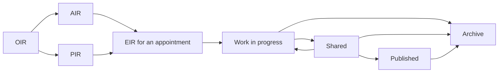

# ISO 19650-1 — Concepts, requirements, and the common data environment

## 1. Purpose of this part

ISO 19650-1:2018 sets out concepts and principles for managing information at the maturity the series calls “building information modelling (BIM) according to the ISO 19650 series”. The open abstract describes a framework for exchanging, recording, versioning, and organizing information for all actors, across the life cycle of a built asset, and says the document can be scaled to the asset and to the procurement route. [P1-S01]

The standard is a recommendations document in that abstract, not a claim that every later part is optional. Parts 2 and 3 turn the concepts into a management process. This part is the vocabulary and the structure those processes use. [P1-S01] [P1-S03]

A second edition is in draft and is not the text to study yet. The 2018 edition remains the published standard. [P1-S02]

## 2. Key concepts

### Appointing party, lead appointed party, and appointed party

The appointing party is the party that appoints others to do work and to deliver information. On a project this is often the client, but the term is wider than “client”, “owner”, or “employer”. The lead appointed party coordinates information inside a delivery team and between that team and the appointing party. An appointed party provides information about works, goods, or services. A delivery team is the lead appointed party together with its task teams. A task team produces a defined package of information. [P1-S03]

Practical example. A hospital trust (appointing party) appoints a main contractor (lead appointed party). The contractor appoints a structural steel fabricator (appointed party) whose detailers are a task team. The trust can have several lead appointed parties at once, for example a design team and a construction team, each with its own delivery team. [P1-S03]

### Appointment

An appointment is the agreement under which information is managed or produced. In the UK that agreement is usually a contract. The project’s information protocol is established by the appointing party and included in each appointment, then passed into sub-appointments. [P1-S03]

### Information requirements cascade

The appointing party should understand what information it needs about its assets or projects in order to support its objectives. Guidance Part 1, citing ISO 19650-1 clause 5, lists four resources: organizational information requirements (OIR), project information requirements (PIR), asset information requirements (AIR), and exchange information requirements (EIR). [P1-S03]

Guidance Part D is more precise about the order. OIR are the organizational starting point (ISO 19650-1 clause 5.2 and ISO 19650-3 clause 5.1.2). AIR and PIR are both derived from OIR. AIR relate the high-level needs to specific assets (ISO 19650-1 clause 5.3 and ISO 19650-3 clause 5.1.4). PIR are the single high-level set for one project (ISO 19650-1 clause 5.4 and ISO 19650-2 clause 5.1.2). EIR then state, for one appointment, the information to be delivered at each exchange (ISO 19650-1 clause 5.5, ISO 19650-2 clause 5.2.1, and ISO 19650-3 clause 5.2.2). Lead appointed parties may add their own EIR when they appoint others (ISO 19650-2 clause 5.4.3). [P1-S05]

The checklist “OIR, then PIR and AIR in parallel, then EIR” matches this guidance. It is not “OIR then PIR then AIR” as a single chain. AIR is not a project deliverable. It is an asset-level requirement from which operational EIR are drawn. [P1-S05]

Practical example. A university’s OIR include a purpose “report annual energy use”. The AIR for a teaching building asks for metered consumption by floor. The PIR for a refurbishment project asks for enough design information to decide whether the project is affordable at the end of concept design. The EIR for the mechanical designer then names the containers, the level of information need, and the exchange dates that satisfy those purposes. [P1-S05]

### Project information model and asset information model

An information model is a set of information containers, not a single geometric model. Models exist at asset, project, and delivery-team level. The project information model (PIM) is the information model developed for delivery. The asset information model (AIM) is the information model used while the asset is in operation. The direction and timing of transfer between them are set out in folder 03. [P1-S03]

### Information container

Guidance Part 1 cites ISO 19650-1 clause 3.3.12 for the definition and explains the idea in its own words: a container is a named, uniquely identified unit of information, such as a model, a drawing, a schedule, or a specification. Containers are broken down so that different appointed parties can work at the same time without overwriting each other. The federation strategy is the higher-level explanation of why the model is divided that way (ISO 19650-1 clause 10.4). [P1-S03]

Practical example. “School-STR-XX-02-DR-S-0004” might be one container for a second-floor structural drawing. The federated model used for coordination is an arrangement of containers, not a new kind of container that replaces them. [P1-S03]

### Common data environment states

ISO 19650-1 Figure 10, explained in clause 12 and redrawn in Guidance Part C, shows four ideas that run together: work in progress, shared, published, and archive. Work in progress is information the originator or task team is developing, not visible to others. Shared information has been approved for sharing with other task teams, delivery teams, or the appointing party. Published information has been authorized for a more binding use, such as detailed design, construction, or asset management. Archive is the journal of the container’s development, not a place where information goes to die. [P1-S04]

The figure is a simplification. A container can move back from shared to work in progress, and more than one solution can hold the states. [P1-S04]

ISO 19650-1 clause 12.1, as cited by Guidance C, recommends a revision code, a status code, and a classification code on each container. ISO 19650-2 clause 5.1.7 then requires the CDE to support those codes. The UK National Annex adds a naming and revision pattern. That annex is national guidance, not part of the international text. [P1-S04]

### Level of information need

Level of information need is the framework for deciding how much information is enough at an exchange. It is used to avoid both too little information and wasteful extra information. The term is not abbreviated. The concept is introduced in ISO 19650-1 clause 11.2. The appointing party sets the method in the project’s information standard and applies it in the EIR. Each container’s level of information need is then recorded in the task information delivery plan. [P1-S03]

Guidance D, still citing clause 11.2, says information should be defined across geometrical information, alphanumerical information, and documentation. A later international standard for this method is recorded in folder 06. The February 2021 guidance is earlier than that standard. [P1-S05]

Practical example. For a fire door at technical design, the geometrical need may be the opening size and swing, the alphanumerical need may be the fire rating and the asset identifier, and the documentation need may be the test certificate. Asking for manufacturer fabrication geometry at that exchange would usually be more than the purpose requires. [P1-S03] [P1-S05]

## 3. Process

The concepts do not form a project programme by themselves. They set the order in which requirements are made, containers are produced, and states change.

1. The appointing party states purposes and high-level requirements (OIR, then AIR and PIR). [P1-S05]
2. For each appointment it states EIR, the information standard, the production methods, and the information protocol. [P1-S03] [P1-S05]
3. Task teams develop containers in work in progress. [P1-S04]
4. Containers are checked and then shared for coordination or comment. [P1-S04]
5. After authorization and acceptance, containers are published for a permitted use. [P1-S04]
6. Each transition is archived so the history remains. [P1-S04]
7. Accepted project information that the owner needs in use is transferred toward the asset information model. The operational rules for that transfer are in folder 03. [P1-S03]

## 4. Glossary

| Term | Acronym | Paraphrased definition | Defined in | OBP/guidance link | Confidence |
| --- | --- | --- | --- | --- | --- |
| Appointing party | — | Party that receives information from a lead appointed party under an appointment. Not limited to the word “client”. | ISO 19650-1, as explained in Guidance Part 1; the IMI site uses the same explanation | [P1-S03] | High |
| Lead appointed party | — | Party accountable for coordinating information between task teams, or between a delivery team and the appointing party. | Guidance Part 1 table, citing the ISO 19650 series | [P1-S03] | High |
| Appointed party | — | Party that provides information concerning works, goods, or services. | Guidance Part 1 table | [P1-S03] | High |
| Delivery team | — | A lead appointed party and the task teams associated with it. | Guidance Part 1 table | [P1-S03] | High |
| Task team | — | Team that produces information for a defined task. The TIDP is prepared per task team. | Guidance Part 1 and Part F; see folder 02 | [P1-S03] | High |
| Organizational information requirements | OIR | High-level information the organization needs across its asset portfolio and business functions. | ISO 19650-1 clause 5.2, as cited by Guidance D | [P1-S05] | High |
| Asset information requirements | AIR | Information the owner or operator needs about an asset, derived from OIR. | ISO 19650-1 clause 5.3, as cited by Guidance D | [P1-S05] | High |
| Project information requirements | PIR | The one high-level set of information needed for key decisions on a single project. | ISO 19650-1 clause 5.4, as cited by Guidance D | [P1-S05] | High |
| Exchange information requirements | EIR | Appointment-level statement of what information is delivered at each exchange. | ISO 19650-1 clause 5.5, as cited by Guidance D | [P1-S05] | High |
| Information container | — | Uniquely identified unit of information inside an information model. | ISO 19650-1 clause 3.3.12, as cited by Guidance Part 1 | [P1-S03] | High |
| Common data environment | CDE | The workflow and solutions through which container states and metadata are managed. The guidance treats the workflow and the technology as related but not identical. | ISO 19650-1 clause 12 and Figure 10, as explained in Guidance C | [P1-S04] | High |
| Level of information need | — | Framework for how much geometrical, alphanumerical, and documentary information is required. Not abbreviated. | ISO 19650-1 clause 11.2, as cited by Guidance Part 1 and Guidance D | [P1-S03] [P1-S05] | High |
| Project information model | PIM | Information model for the delivery phase. | Used throughout the UK guidance; the transfer diagram is in Guidance Part 3 | [P1-S03] | High |
| Asset information model | AIM | Information model for the operational phase. | Same | [P1-S03] | High |

OBP links are omitted because the preview did not load. Clause numbers above are the numbers the UK guidance cites. They were not re-read from the paid standard.

## 5. Common misconceptions

- “LOD” is the ISO term for how detailed a model is. The guidance says the term is “level of information need” and that it is not abbreviated. LOD and “level of detail” belong to older national toolkits and are only examples of a framework, not the international term. [P1-S03]
- An information model means the federated 3D model. The guidance says a model is any collection of information containers. [P1-S03]
- Shared and published are the same state with two names. Shared information has been approved for sharing. Published information has been authorized and accepted for a contractual or operational use. [P1-S04]
- The CDE is a software product. Guidance C treats the state workflow as the concept, and any particular system as a solution that has to support it. [P1-S04]
- The July 2019 concepts guidance is still right about security. Section 3.3 tells readers to use PAS 1192-5 until ISO 19650-5 is published. Part 5 was published in 2020. Use folder 05. [P1-S03]

## 6. Links to other parts

- Delivery activities, BEP, TIDP, MIDP, and the risk register: [folder 02](../02_ISO_19650_2_Delivery_Phase/summary_and_terms.md).
- AIR, AIM, and trigger events: [folder 03](../03_ISO_19650_3_Operational_Phase/summary_and_terms.md).
- The quality checks before sharing and publishing: [folder 04](../04_ISO_19650_4_Information_Exchange/summary_and_terms.md).
- Security of sensitive containers: [folder 05](../05_ISO_19650_5_Security/summary_and_terms.md).
- The current level-of-information-need standard and IDS: [folder 06](../06_Templates_LOIN_and_OpenBIM/summary_and_terms.md).

## 7. Open questions / unverified items

- The wording of the ISO definitions in clauses 3 and 5 was not read. Only the guidance’s citations and paraphrases are used.
- The OBP preview did not load, so it is unverified whether a free preview of clause 3 exists.
- ISO/DIS 19650-1 may change titles or clause numbers. Its text was not read. [P1-S02]
- A UK National Annex to Part 2 specifies container identification. This note does not restate that annex. [P1-S04]

## 8. Language notes

### Collocations

- establish the information requirements — decide and record what information is needed
- appoint a lead appointed party — enter an appointment with the coordinating party
- issue an information container — place a container into the CDE for the next state
- share information for coordination — make it available outside the authoring task team
- authorize and accept a deliverable — the lead appointed party authorizes; the appointing party accepts
- specify the level of information need — state how much information is enough
- federate information containers — bring containers together for a purpose without merging their authorship
- derive the EIR from the PIR — turn a project purpose into appointment-level requirements
- apply the information standard — follow the agreed rules for identification, classification, and method
- transfer information from the PIM to the AIM — move accepted delivery information into operational use
- cascade requirements to the supply chain — pass requirements down to the party best able to produce them
- record a revision and a status — metadata that says which version this is and what it may be used for

### Formal patterns

Standards and guidance separate “shall” (a requirement), “should” (a recommendation), and “may” (a permission). ISO 19650-4’s abstract adds “shall consider”, which is explained in folder 04. “In accordance with” means the work has to follow a named document. “Prior to” means before the next activity, and it is preferred to “before” in these texts. “Where applicable” limits a rule to the cases where it is relevant.

### Easily confused terms

- Appointing party / appointed party. The appointing party asks and receives. The appointed party produces.
- Requirement / specification. A requirement states the need. A specification, in the IDS sense, is a structured check. An EIR can be written in prose and later expressed as an IDS.
- Shared / published. See the misconception above.
- Information model / information container. The model is the collection. The container is one managed unit.

### Model sentences

The appointing party shall establish the project’s information requirements before it invites a lead appointed party to tender, so that each exchange has a stated purpose.

An information container remains work in progress until the task team has checked it and approved it for sharing with the other task teams.

Level of information need is specified for a purpose and an exchange; it is not a single grade that applies to the whole model for the life of the project.
