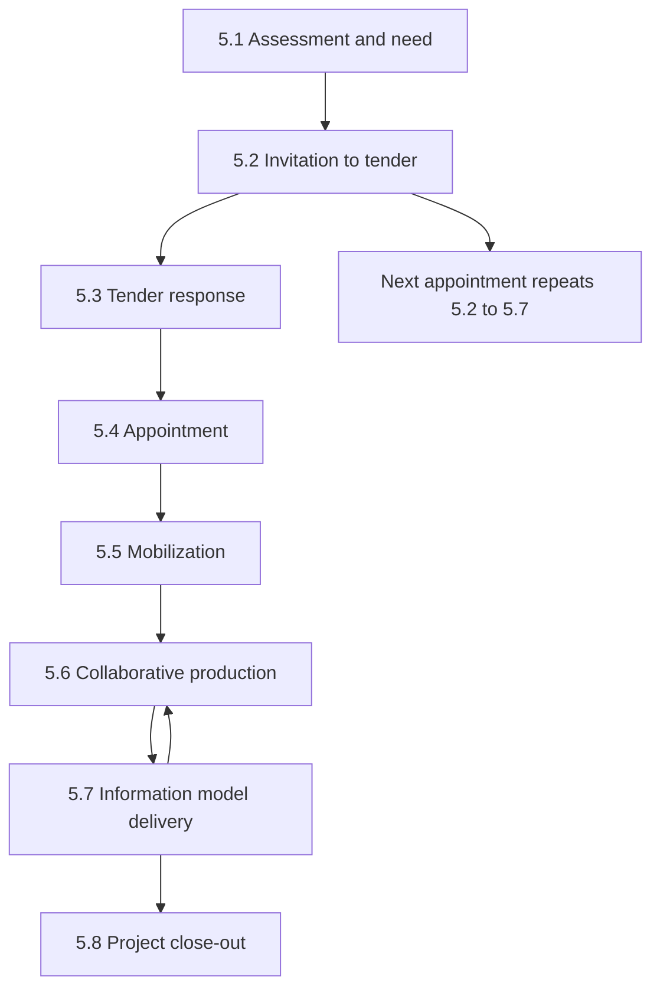

# ISO 19650-2 — Delivery phase

## 1. Purpose of this part

ISO 19650-2:2018 specifies a management process for information during the delivery phase of an asset, including the exchanges inside that phase, using building information modelling. The open abstract says it can be used for any asset type and by organizations of any size, whatever procurement route they choose. [P2-S01]

The published edition is still the 2018 text. A draft second edition, retitled as an information-management process, is in enquiry and is catalogued as the future replacement of both this part and Part 3. Do not study the draft as if it were published, and do not assume from the abstract alone that the operational phase has already been merged into Part 2. [P2-S02]

UK guidance Edition 6 (February 2021) is the open process commentary used here. It includes a section on the 2021 UK National Annex. The annex itself is national and is not restated. [P2-S03]

## 2. Key concepts

### The eight activities

Guidance Part 2 presents clause 5 as eight activities. Activities 5.1 and 5.8 belong to the project as a whole. Activities 5.2 to 5.7 are repeated for each appointment. [P2-S03]

| Clause | Activity | Who is primarily active |
| --- | --- | --- |
| 5.1 | Assessment and need | Appointing party |
| 5.2 | Invitation to tender | Appointing party |
| 5.3 | Tender response | Prospective lead appointed party |
| 5.4 | Appointment | Lead appointed party, with the appointing party |
| 5.5 | Mobilization | Lead appointed party and delivery team |
| 5.6 | Collaborative production of information | Task teams and lead appointed party |
| 5.7 | Information model delivery | Lead appointed party, then appointing party for acceptance |
| 5.8 | Project close-out | Appointing party |

The spelling “mobilization” is the spelling in Edition 6. UK English also uses “mobilise”. The activity is the same. [P2-S03]

Practical example. A client assessing a school project (5.1) prepares PIR, milestones, an information standard, production methods, reference information, and an information protocol. It then invites a contractor to tender (5.2). The contractor returns a pre-appointment BIM execution plan and a risk register (5.3). After award, the contractor confirms the plan, agrees the responsibility matrix, and compiles the MIDP (5.4) before anyone relies on production.

### Pre-appointment and post-appointment BIM execution plan

The BIM execution plan is defined, according to the guidance, in ISO 19650-2 clause 3.1.3.1. The pre-appointment plan is established by the prospective lead appointed party and included in the tender response (clause 5.3.2). Clause 5.3.2 identifies seven areas the prospective party should consider. The guidance does not list those seven areas in the extract used here, so they are not invented. After appointment, clause 5.4.1 is the confirmation of the delivery team’s BIM execution plan. That confirmed plan is the post-appointment plan. It is not a second unrelated document. [P2-S03]

The pre-appointment plan is also where the prospective lead appointed party can propose changes to the information standard or the production methods, including changes needed for secure distribution. [P2-S03]

### Responsibility matrix

There are two different matrices, and the guidance warns not to mix them. [P2-S03] [P2-S05]

1. A matrix of information-management activities. ISO 19650-2 Annex A is an indicative template. Clause 5.1.1 is the related activity. [P2-S03]
2. A matrix of information deliverables. There is no template in the ISO series. It starts as a high-level matrix inside the pre-appointment BIM execution plan and is refined into a detailed matrix, which then informs the TIDPs and the MIDP (clauses 5.3.2, 5.4.1, 5.4.2, 5.4.4, and 5.4.5). [P2-S03] [P2-S05]

Practical example. A high-level row at tender might say “the structural task team produces the primary frame model for coordination at the end of developed design”. The detailed row later names the container, the author, the milestone, and the level of information need.

### TIDP and MIDP

Every task team produces a task information delivery plan (TIDP) under clause 5.4.4. The guidance says the TIDP schedules the agreed information containers and, for each one, identifies its name and title, predecessors or dependencies, level of information need, estimated production time, author, and delivery milestones. The lead appointed party compiles the TIDPs into one master information delivery plan (MIDP) under clause 5.4.5. The standard does not mandate a single template. [P2-S05]

### Information protocol

The appointing party establishes the project’s information protocol (clause 5.1.8) and includes it in tender and appointment documents. It sets out rights and obligations of the two parties to an appointment that involves managing or producing information. It is an appointment resource, not an optional explanation. The UK templates are examples for appointments governed by English law. They are not legal advice. ISO 19650-5 does not use the term, but clause 9.2 still has to be provided for in appointment documents. [P2-S06] [P2-S07] [P2-S08]

### Risk register

Clause 5.3.6 requires the prospective lead appointed party to establish the delivery team’s risk register. The appointing party looks at information-delivery risk in the tender response. ISO 19650-1 clause 6.3.1, cited in the concepts guidance, is the principle that information risk sits inside ordinary risk management. The register is about timely and suitable information, not a duplicate of the construction health-and-safety register. [P2-S03]

Practical example. A risk entry might be: “the specialist subcontractor cannot be identified before tender, so the federation strategy in the pre-appointment plan is provisional.” The mitigation is to confirm the strategy during mobilization and before the first shared exchange.

### Other resources created before tender

Guidance A’s table, which cites the clauses, includes the project’s information standard (5.1.4), production methods and procedures (5.1.5), reference information and shared resources (5.1.6), information delivery milestones (5.1.3), EIR (5.2.1), and tender response requirements (5.2.3). “Shared resources” here means things such as templates and object libraries, not the CDE state called Shared. [P2-S06]

## 3. Process

1. Assess the project need and prepare project-level resources. [P2-S03] [P2-S06]
2. For each appointment, establish EIR, evaluation criteria, and the invitation. [P2-S03]
3. Receive the pre-appointment BIM execution plan, capability statement, mobilization plan, and risk register. [P2-S03]
4. Appoint, confirm the BIM execution plan, agree the detailed responsibility matrix, and establish the MIDP from the TIDPs. [P2-S03] [P2-S05]
5. Mobilize people and technology, and test the information production methods before routine production. Clauses 5.5.1, 5.5.2, and 5.5.3 are the mobilization tasks named in the guidance. [P2-S03]
6. Produce information, check it in the task team, and review it in the lead appointed party. The guidance points to clauses 5.6.3 to 5.6.5 and 5.7.1 to 5.7.4 for the layers of review. Part 4 adds the quality criteria for the exchange itself. [P2-S03]
7. The appointing party reviews and accepts the information model (clause 5.7.4). [P2-S03]
8. Close out the project, including lessons learned. [P2-S03]

## 4. Glossary

| Term | Acronym | Paraphrased definition | Defined in | OBP/guidance link | Confidence |
| --- | --- | --- | --- | --- | --- |
| Assessment and need | — | Project-level activity in which the appointing party prepares the information-management rules and requirements. | ISO 19650-2 clause 5.1 | [P2-S03] | High |
| BIM execution plan | BEP | Plan by which the delivery team proposes, and later confirms, how it will meet the information requirements. | ISO 19650-2 clause 3.1.3.1, as cited by Guidance Part 2 | [P2-S03] | High |
| Pre-appointment BEP | — | The BEP included in the tender response. | ISO 19650-2 clause 5.3.2 | [P2-S03] | High |
| Task information delivery plan | TIDP | A task team’s schedule of the containers it will deliver. | ISO 19650-2 clause 5.4.4 | [P2-S05] | High |
| Master information delivery plan | MIDP | The lead appointed party’s compilation of the delivery team’s TIDPs. | ISO 19650-2 clause 5.4.5 | [P2-S05] | High |
| Responsibility matrix | — | Either a matrix of management activities or a matrix of deliverables. The guidance treats these as different tools. | ISO 19650-2 Annex A and clauses 5.4.2 and 5.4.4 | [P2-S03] [P2-S05] | High |
| Information protocol | — | Appointment document setting rights and obligations for information. | ISO 19650-2 clause 5.1.8 | [P2-S07] | High |
| Information standard | — | Project rules for how information is identified, classified, and structured. | ISO 19650-2 clause 5.1.4 | [P2-S06] | High |
| Information production methods and procedures | — | Project methods for producing, reviewing, and exchanging information. | ISO 19650-2 clause 5.1.5 | [P2-S06] | High |
| Risk register | — | Delivery team’s record of risks to timely and suitable information delivery. | ISO 19650-2 clause 5.3.6 | [P2-S03] | High |
| Mobilization | — | Activity of getting resources, technology, and methods ready before production. | ISO 19650-2 clause 5.5 | [P2-S03] | High |

## 5. Common misconceptions

- The BIM execution plan is written once by the client. The client may issue a template, but the pre-appointment plan is established by the prospective lead appointed party, and it is confirmed after appointment. [P2-S03]
- The MIDP replaces the TIDPs. The MIDP is compiled from them. Each task team still owns its TIDP. [P2-S05]
- Annex A is a responsibility matrix for every drawing. Annex A is described as an indicative matrix of information-management activities. Deliverable responsibility is a separate matrix, and the standard does not supply its template. [P2-S03] [P2-S05]
- A risk register under clause 5.3.6 is the project’s general construction-risk register. The guidance places it in the tender response as information-delivery risk. [P2-S03]
- “Shared resources” in clause 5.1.6 means the Shared state of the CDE. In Guidance A the phrase means reference material such as templates and libraries. [P2-S06]

## 6. Links to other parts

- Concepts, parties, and CDE states: [folder 01](../01_ISO_19650_1_Concepts_and_CDE/summary_and_terms.md).
- What happens to the PIM after close-out: [folder 03](../03_ISO_19650_3_Operational_Phase/summary_and_terms.md).
- Criteria for accepting an exchange: [folder 04](../04_ISO_19650_4_Information_Exchange/summary_and_terms.md).
- Clause 9.2 and the security management plan: [folder 05](../05_ISO_19650_5_Security/summary_and_terms.md).
- How an EIR line can be tested in IDS: [folder 06](../06_Templates_LOIN_and_OpenBIM/summary_and_terms.md).

## 7. Open questions / unverified items

- The seven considerations inside clause 5.3.2 were cited but not listed in the passage read. They are UNVERIFIED here. Read them in a licensed copy or in Guidance E if that section quotes them. [P2-S03]
- ISO/DIS 19650-2 may renumber these activities. The draft was not read. [P2-S02]
- The UK National Annex naming rules are intentionally not copied.

## 8. Language notes

### Collocations

- invite tenders for an appointment — ask prospective lead appointed parties to respond
- establish the pre-appointment BIM execution plan — prepare the tender version of the plan
- confirm the delivery team’s BIM execution plan — agree the plan after appointment
- compile the master information delivery plan — assemble the task plans into one plan
- mobilize the delivery team — make people, technology, and methods ready
- establish the delivery team’s risk register — record information-delivery risks
- incorporate the information protocol — make it part of the appointment
- review and accept the information model — the appointing party’s decision at delivery
- cascade exchange information requirements — pass requirements to appointed parties
- test the project’s information production methods — try the methods before routine production
- identify predecessors and dependencies — state which containers must exist first
- capture lessons learned — record what close-out should pass to the next project

### Formal patterns

“The lead appointed party shall establish the master information delivery plan” is a requirement pattern. “The prospective lead appointed party should consider” leaves the depth of consideration to the appointment. “In accordance with the project’s information standard” ties a container to rules that already exist. “Prior to the invitation to tender” fixes the order of clause 5.1 before clause 5.2.

### Easily confused terms

- Pre-appointment BEP / confirmed BEP. The first supports selection. The second is the agreed plan for production.
- TIDP / MIDP. The first is one task team. The second is the delivery team’s compilation.
- Information protocol / information standard. The protocol is about rights and obligations. The standard is about how information is structured.
- Shared resources / Shared state. See the misconception above.

### Model sentences

During tender the prospective lead appointed party establishes a pre-appointment BIM execution plan and a risk register, which the appointing party evaluates before making the appointment.

Each task team prepares a task information delivery plan, and the lead appointed party compiles those plans into the master information delivery plan.

The project’s information protocol is included in the appointment so that the rights and obligations for information are agreed before production begins.
