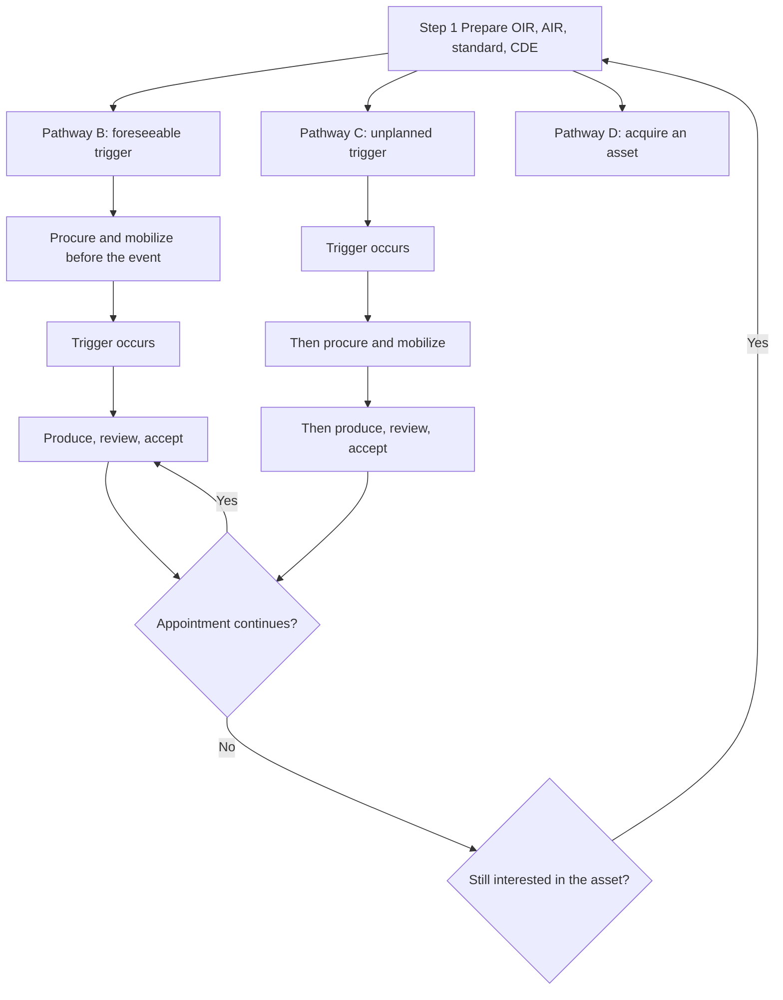

# ISO 19650-3 — Operational phase

## 1. Purpose of this part

ISO 19650-3:2020 specifies a management process for information during the operational phase, when the asset is in use, including the exchanges inside that phase. The open abstract says organizations of any size can meet the requirements themselves or delegate them. [P3-S01]

The project leader’s 2020 note describes the standard as the counterpart of Part 2 for the relationship between the asset owner or operator and the contractors or works teams who maintain, repair, or monitor the asset. Information produced at the end of a Part 2 project is the starting operational information, so delivery teams need Part 3 as well. [P3-S04]

The 2020 text remains the published standard, but the catalogue shows two draft projects that are both described as future replacements of this part. Their titles differ from the 2020 title. Read the currency note in `sources.md` before you assume the eight-step flowchart will survive unchanged. [P3-S01] [P3-S02]

## 2. Key concepts

### Appointing party in operation

In this part the appointing party is the asset owner, operator, or the person acting for them. A lead appointed party may be an external contractor or an in-house works team. The same process applies to both. A term appointment with call-off orders is still an appointment. [P3-S03]

### OIR and AIR

Organizational information requirements and asset information requirements are established in the preparatory step. Guidance D cites ISO 19650-3 clause 5.1.2 for OIR and clause 5.1.4 for AIR. AIR are defined before any related appointment and are led, where the organization has one, by the asset or facilities team. Operational EIR (the guidance writes “EIR (ISO 19650-3)”) are drawn from the AIR under clause 5.2.2. [P3-S05] [P3-S07]

Practical example. An airport operator’s OIR include “keep rescue access routes available”. The AIR for the terminal asks for the current width and obstruction status of those routes. The EIR for a survey contractor asks for a dated plan and a schedule of obstructions after each inspection.

### Trigger events

A trigger event is an event in the asset life cycle that changes the asset, or the information needed about it. Foreseeable events include planned maintenance and inspections. Unforeseeable or impractical-to-plan events include damage, sudden demand, or a new project. Acquisition of an asset from another owner is a third kind of event, because the buyer cannot always demand information as part of the price. Clause 5.1.5 is the clause the guidance cites for identifying foreseeable trigger events. [P3-S03]

The tempo of operation is the sequence of trigger events, in the same way that a plan of work gives tempo to a project. [P3-S03]

### PIM to AIM

Guidance Part 3’s reading of the standard’s life-cycle figure uses three markers. At the start of delivery, relevant information is transferred from the AIM to the PIM. At the start of operation, relevant information is transferred from the PIM to the AIM. During the operational phase, trigger events cause further updates. The note in the guidance says information can also be transferred between the PIM and the AIM during delivery, not only at the two end points. [P3-S03]

The appointing party reviews and accepts what each lead appointed party delivers, and then updates or replaces the content in the enterprise systems that hold the AIM. Acceptance does not by itself prove that later use will find the information complete. The information protocol is how the appointment explains that responsibility. [P3-S03] [P3-S06]

Practical example. At handover of a new ward, the contractor’s PIM contains the as-built model and the commissioning certificates. The hospital accepts the containers that meet the AIR and files them into the AIM. A later boiler service is a trigger event that updates only the containers the AIR named for that event.

### Eight steps, three pathways

The guidance says the process has eight steps, numbered 1 to 8, matching clause 5.1 to clause 5.8. Step 1 is preparation by the appointing party: organizational and asset requirements, the asset information standard, and the CDE. After step 1 the flowchart splits. [P3-S03]

- Pathway B: the trigger is foreseen. Procurement (clauses 5.2 and 5.3) and planning or mobilization (clauses 5.4 and 5.5) happen before the event. When the event occurs, production (clauses 5.6 and 5.7) can start. [P3-S03]
- Pathway C: the trigger is not planned. The event happens first, and only then come procurement, mobilization, and production. [P3-S03]
- Pathway D: the organization acquires an asset. This is not the same commercial relationship as a works appointment. [P3-S03]

Inside B and C, the guidance groups the work as E (procurement), F (planning), and G (production). Point K asks whether the appointment continues after this delivery, for example a five-year inspection contract. Point L asks whether the owner still has an interest in the asset at all. [P3-S03]

The guidance also says some Part 3 tasks, including the delivery team’s BIM execution plan, are deliberately lighter than their Part 2 equivalents. Proportionality is a requirement of approach, not an excuse to skip a statutory information need. [P3-S03]

## 3. Process

1. Establish OIR, AIR, foreseeable trigger events, the asset information standard, and the CDE. [P3-S03] [P3-S05]
2. For a foreseeable event, appoint and mobilize before it happens. [P3-S03]
3. For an unplanned event, start procurement only when the event has occurred. [P3-S03]
4. Produce information to the EIR, review it, and accept it into the AIM. [P3-S03]
5. Decide whether the appointment continues and whether the asset is still in the portfolio. [P3-S03]

## 4. Glossary

| Term | Acronym | Paraphrased definition | Defined in | OBP/guidance link | Confidence |
| --- | --- | --- | --- | --- | --- |
| Operational phase | — | The period in which the asset is used for its intended purpose. | ISO 19650-3 abstract and the 2020 project-leader note | [P3-S01] [P3-S04] | High |
| Trigger event | — | A life-cycle event that creates a need for new or updated asset information. | ISO 19650-3 clause 5.1.5, as cited by Guidance Part 3 | [P3-S03] | High |
| Asset information model | AIM | The operational information model, kept so that it continues to represent the asset. | Guidance Part 3, reading the standard’s life-cycle figure | [P3-S03] | High |
| Project information model | PIM | The delivery-phase model from which relevant information is transferred at the start of operation. | Guidance Part 3 figure notes | [P3-S03] | High |
| Asset information requirements | AIR | Asset-level requirements, established by the appointing party before related appointments. | ISO 19650-3 clause 5.1.4 | [P3-S05] | High |
| EIR (ISO 19650-3) | EIR | Exchange requirements for an operational appointment, distinguished by the guidance from delivery EIR. | ISO 19650-3 clause 5.2.2 | [P3-S05] | High |
| Asset information protocol | — | The Part 3 form of the information protocol, included in operational appointments. | ISO 19650-3, as explained in the protocol guidance and template | [P3-S06] | High |
| Proportionality | — | Applying the process at a depth that matches the asset, the event, and the value of the information. | Guidance Part 3, section 4.3 | [P3-S03] | High |

## 5. Common misconceptions

- Part 3 begins only at handover of a new building. The guidance gives use cases for existing assets, portfolios, and surveys, as well as the first transfer from a PIM. [P3-S03]
- In-house maintenance teams are outside the standard. The guidance says an in-house works team is still a lead appointed party or appointed party, and the same steps apply, usually in a simpler form. [P3-S03]
- Every trigger can be planned. Pathway C exists because some events cannot reasonably be procured in advance. [P3-S03]
- Accepting the PIM automatically creates a complete AIM. Only the information the AIR and EIR required, and which the appointing party accepts, is taken in. The owner then maintains it. [P3-S03] [P3-S04]
- PAS 1192-3 is still the operational standard. It is the predecessor. The published ISO process is Part 3. [P3-S01]

## 6. Links to other parts

- The requirement cascade and the CDE states used during production: [folder 01](../01_ISO_19650_1_Concepts_and_CDE/summary_and_terms.md).
- The delivery activities that create the PIM: [folder 02](../02_ISO_19650_2_Delivery_Phase/summary_and_terms.md).
- Exchange criteria that also apply to operational trigger events: [folder 04](../04_ISO_19650_4_Information_Exchange/summary_and_terms.md).
- Security of operational information: [folder 05](../05_ISO_19650_5_Security/summary_and_terms.md).

## 7. Open questions / unverified items

- The detailed names of every sub-clause inside 5.2 to 5.8 were not copied from the standard. The grouping into procurement, planning, and production is the guidance’s reading of the flowchart. [P3-S03]
- How ISO/DIS 19650-2 and ISO/DIS 19650-3 will divide this material is UNVERIFIED. Both are said to replace the 2020 standard, and they do not have the same title. [P3-S01] [P3-S02]
- Enterprise systems such as CAFM are mentioned as places the AIM may live. The standard, as described here, does not require one named product. [P3-S03]

## 8. Language notes

### Collocations

- identify foreseeable trigger events — list the events that can be planned
- establish the asset information requirements — set what the operator needs to know
- mobilize in readiness for a trigger — be appointed and prepared before the event
- respond to an unplanned trigger — start the process after the event
- transfer relevant information from the PIM to the AIM — move accepted delivery information into operation
- maintain the asset information model — keep it aligned with the asset
- accept an information deliverable — the appointing party’s decision to take it in
- apply the process proportionately — match the effort to the asset and the event
- make a term appointment — appoint once for repeated call-off work
- update an enterprise system — file accepted information where the operator uses it
- distinguish operational EIR from delivery EIR — keep the two requirement sets apart
- retain an interest in the asset — decide whether the information process continues

### Formal patterns

“The requirements can be achieved through direct actions or can be delegated” is the abstract’s way of saying the organization remains responsible even when a contractor does the work. “Prior to the trigger event” is the Pathway B order. “In accordance with the asset information standard” means the container follows rules set in step 1, not rules invented at the moment of upload.

### Easily confused terms

- AIR / AIM. The AIR is the requirement. The AIM is the model that results.
- Trigger event / information exchange. The event creates the need. The exchange is the delivery of information in response.
- Pathway B / Pathway C. B prepares before the event. C starts because the event has already happened.

### Model sentences

The appointing party identifies foreseeable trigger events in the asset information requirements, and it appoints the works team before those events occur.

When a trigger cannot reasonably be planned, procurement and mobilization take place after the event and before information production begins.

Information accepted from the project information model is incorporated into the asset information model only to the extent that it meets the asset information requirements.
