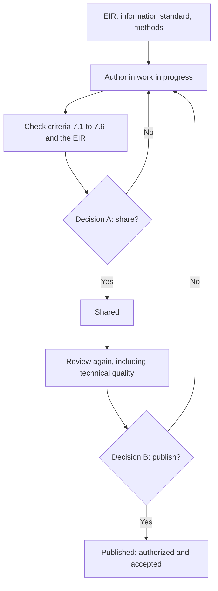

# ISO 19650-4 — Information exchange

## 1. Purpose of this part

ISO 19650-4:2022 specifies the detailed process and the decision criteria for an information exchange under the ISO 19650 series, so that the resulting project information model or asset information model is fit to use. The open abstract says it implements concepts from Part 1 and applies both to delivery stages in Part 2 and to operational trigger events in Part 3. It is written for assets of any size, and it expects the requirements to be applied in proportion to that size. [P4-S01]

The standard is short (12 pages) and uses the phrase “shall consider”. The abstract explains that phrase in the open text: the person must think carefully about each listed item, and the time and evidence required depend on the asset, the experience of the people, and any national policy. On a small asset some items can be dismissed quickly, provided the dismissal is a real decision. [P4-S01]

UK Guidance 4 (March 2023) is the open commentary. It says it does not change the meaning of the standard. [P4-S02]

## 2. Key concepts

### Information provider, receiver, and reviewer

Parts 1, 2, 3, and 5 name appointing, lead appointed, and appointed parties. For a single exchange, Part 4 also uses information provider, information receiver, and information reviewer, because the same organization can change role as the container moves through the CDE. The guidance says the criteria at the two key decision points are the same: the applicable EIR (and the supporting standard and methods) plus the quality criteria in clause 7. Technical quality is also reviewed. [P4-S02]

Practical example. A mechanical task team is the provider when it shares a plant model. The lead appointed party’s coordinator is the reviewer at the first decision. The client’s engineer is the receiver when the container is offered for acceptance. On the next exchange the client may become the provider of reference information back to the team.

### Decision points

Guidance 4’s Figure 1 places two decision points, A and B, on the CDE process. The figure itself was not copied. The text says both points use the same criteria. Point A is the decision associated with sharing during development. Point B is the decision associated with publishing after authorization and acceptance. The guidance’s own summary of CDE behaviour is to share early and often while information is developing, and to publish once, when it has been authorized and accepted. [P4-S02]

Guidance C, which Part 4 tells the reader to use for CDE operation, defines published information as information the lead appointed party has authorized and the appointing party has accepted. Shared information is for use outside the authoring task team before that acceptance, including comment and coordination. [P4-S03]

### Six information criteria

Clauses 7.1 to 7.6 are six criteria for the quality of the exchanged information. The guidance says they are mostly independent of any one client’s functional requirements, which is why they can be standardized. Clause 7.7 says the standard does not prescribe the functional, technical, or similar criteria. Those remain in the EIR. [P4-S02]

| Clause | Focus in Guidance 4 | Example given by the guidance |
| --- | --- | --- |
| 7.1 Common data environment | Naming and metadata | A name that does not follow the agreed national annex |
| 7.2 Conformance | Exchange schema and data format | An XML file that is not well formed |
| 7.3 Continuity | Correspondence with other exchanges | A space name that changes between versions without control |
| 7.4 Communication | Loss or change caused by translation or conversion | A date format that is misread |
| 7.5 Consistency | Federation, space, and attributes | The same entity in two models, or a gap between elements, or a weight that disagrees with the product data |
| 7.6 Completeness | Presence and adequacy | Material and volume missing from an element |

The criteria apply to drawings, documents, and sketches as well as to models and databases. Open, structured information makes the checks easier to automate. The guidance also says authoring tools may prevent defects before the exchange, and checking tools may find them afterwards. Both are quality activities. [P4-S02]

### Information sustainability

Guidance 4 says sustainable information is information that continues to exist outside the application that authored it or the application that consumes it. The reason is whole-life use: the same information may later support decisions about cost, carbon, safety, or supply. The informative annexes of the standard, which were not copied, are described as listing candidate open standards for structure, format, and classification. [P4-S02]

Practical example. A pump schedule exported only as a vendor’s native file fails the sustainability aim even if the numbers are correct. An IFC export that meets the EIR, plus a PDF issued for the human record, keeps the information usable after the authoring licence ends. Whether IFC is required is an EIR decision, not an automatic rule of Part 4. [P4-S02]

### What Part 4 does not do

It does not replace the EIR. It does not, in clause 7.7, set the functional content. It does not change the party structure of Parts 2 and 3. The UK National Annex, which the guidance says adds Uniclass on containers and on entities such as zones and products, is a national addition and is not reproduced here. [P4-S02]

## 3. Process

1. Agree the EIR and the methods that the exchange will be judged against. [P4-S02]
2. The provider prepares the container and checks the six criteria before offering it. [P4-S02]
3. At decision A, a reviewer decides whether it can be shared. [P4-S02] [P4-S03]
4. The container may return to work in progress several times. Sharing early is the behaviour the guidance recommends. [P4-S02]
5. At decision B, the container is published only when it has been authorized and accepted. [P4-S02] [P4-S03]
6. The receiver can use published information for the purpose its status allows. Further use in the AIM is a Part 3 activity. [P4-S01] [P4-S03]

## 4. Glossary

| Term | Acronym | Paraphrased definition | Defined in | OBP/guidance link | Confidence |
| --- | --- | --- | --- | --- | --- |
| Information exchange | — | A controlled delivery of information judged against requirements and quality criteria. | ISO 19650-4 abstract | [P4-S01] | High |
| Information provider | — | Party offering the container at that step of the exchange. | ISO 19650-4, as explained in Guidance 4 | [P4-S02] | High |
| Information receiver | — | Party to whom the container is delivered for use or acceptance. | Guidance 4 | [P4-S02] | High |
| Information reviewer | — | Party who checks the container at a decision point. | Guidance 4 | [P4-S02] | High |
| Shall consider | — | A required act of judgement about a listed item, scaled to the asset. | ISO 19650-4 abstract | [P4-S01] | High |
| Conformance | — | Whether the file matches the agreed schema and format. | ISO 19650-4 clause 7.2, as summarised in Guidance 4 | [P4-S02] | High |
| Continuity | — | Whether this exchange still corresponds to previous exchanges. | Clause 7.3, Guidance 4 table | [P4-S02] | High |
| Communication | — | Whether conversion or translation has lost or altered meaning. | Clause 7.4, Guidance 4 table | [P4-S02] | High |
| Consistency | — | Whether federated, spatial, and attribute information agree. | Clause 7.5, Guidance 4 table | [P4-S02] | High |
| Completeness | — | Whether required information is present and adequate. | Clause 7.6, Guidance 4 table | [P4-S02] | High |
| Information sustainability | — | Information that remains usable outside the original software. | Guidance 4, section 6 | [P4-S02] | High |

## 5. Common misconceptions

- Part 4 replaces the EIR with a universal checklist. Clause 7.7, as explained in the guidance, leaves functional and technical criteria to the requirements. The six criteria are additional quality tests. [P4-S02]
- Publishing is what you do when you first upload a file. The guidance reserves publishing for information that has been authorized and accepted, and it recommends sharing many times before that. [P4-S02] [P4-S03]
- “Shall consider” means the item is optional. The abstract says the person is required to think about the item. The outcome may be that it is not relevant. [P4-S01]
- Quality control only happens after export. The guidance also describes quality assurance inside the authoring tool before the exchange. [P4-S02]
- An open format is mandatory for every container. The guidance encourages open standards so that information survives. The EIR still decides the format for each exchange. [P4-S02]

## 6. Links to other parts

- CDE states and metadata: [folder 01](../01_ISO_19650_1_Concepts_and_CDE/summary_and_terms.md).
- Who reviews during clauses 5.6 and 5.7: [folder 02](../02_ISO_19650_2_Delivery_Phase/summary_and_terms.md).
- Trigger events that also need an exchange: [folder 03](../03_ISO_19650_3_Operational_Phase/summary_and_terms.md).
- A machine-readable check of some of the criteria: [folder 06](../06_Templates_LOIN_and_OpenBIM/summary_and_terms.md).

## 7. Open questions / unverified items

- The precise boundary between decision A and decision B was read from the guidance’s prose, not from a reproduction of Figure 1. If the figure uses different labels, this note should be corrected from a licensed copy. [P4-S02]
- The informative annex list of open standards was not copied and is not itemised here.
- No revision of ISO 19650-4 was listed on 26 November 2026. That can change. [P4-S01]
- A direct HEAD request to the Nottingham copy of Guidance 4 returned HTTP 403 on a second attempt. The text used here comes from the successful retrieval earlier the same day.

## 8. Language notes

### Collocations

- execute an information exchange — carry out a defined delivery, not merely send a file
- accept a deliverable — the receiver’s decision that it meets the criteria
- share early and often — put developing information into the shared state for review
- publish once — issue the authorized and accepted container
- fulfil the exchange information requirements — meet what the appointment asked for
- check conformance to the schema — test the file structure
- preserve continuity between versions — keep names and identities stable
- avoid degradation on conversion — do not lose meaning when translating a format
- review technical quality — check the content, not only the metadata
- apply the criteria proportionately — scale the “shall consider” items
- sustain information beyond the application — keep it usable later
- authorize before acceptance — the lead appointed party’s act, which is not the same as the appointing party’s acceptance

### Formal patterns

“Shall” in this part is a requirement. “Shall consider” is still a requirement, but the requirement is to consider, not to adopt every item. “Should”, in the guidance’s description of a national annex, is a strong recommendation about how to implement. “In accordance with the exchange information requirements” is the test at both decision points.

### Easily confused terms

- Provider / appointed party. Provider is a role on one exchange. The appointed party is the role in the appointment, and it may be the provider or, later, a receiver of reference information.
- Reviewer / lead appointed party. The reviewer is whoever the process assigns to the check. That is often the lead appointed party, but the guidance does not say the words are synonyms.
- Conformance / compliance with the EIR. Conformance in clause 7.2 is about schema and format. Meeting the EIR is a separate test.

### Model sentences

Before an information container is shared, the provider checks it against the exchange information requirements and against the quality criteria in ISO 19650-4.

The same container may be shared several times for coordination and is published only after it has been authorized and accepted.

“Shall consider” requires a recorded judgement about each listed item; it does not require every item to be adopted on every project.
