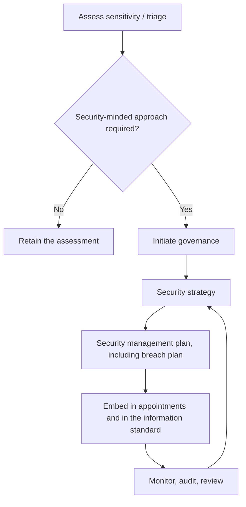

# ISO 19650-5 — Security-minded information management

## 1. Purpose of this part

ISO 19650-5:2020 specifies principles and requirements for a security-minded approach to information management at the maturity described in Part 1, and for sensitive information created or stored in any other initiative, project, asset, product, or service. The open abstract says the approach covers the whole life cycle, whether the asset is planned or already exists, and that it includes building a proportionate security culture and auditing compliance. It is also relevant to commercial information, personal information, and intellectual property. [P5-S01]

The edition was confirmed in October 2025. It is the stable part of the series on the date of this vault. [P5-S01]

The UK framework does not publish a “Guidance Part 5” of its own. It points to the National Protective Security Authority. [P5-S05]

## 2. Key concepts

### What “security-minded” means here

The NPSA describes the standard as a specification for security-minded information management. The aim is to understand vulnerabilities and to apply controls that keep risk at a level the parties can tolerate, without undoing the collaboration that BIM and other digital methods are meant to provide. The same measures can protect commercial information, intellectual property, and personal data, not only national-security assets. [P5-S02] [P5-S03]

The ISO standard replaces PAS 1192-5. The NPSA also says it absorbs key concepts from PAS 185 and PAS 1085, and that its scope is wider than PAS 1192-5 because many organizations face the same problems when they generate and store digital information. Those PAS documents are legacy (predecessor). [P5-S02]

Practical example. A water utility does not publish the internal layout of a pumping station in an open coordination model. It shares a reduced container with the architect and keeps the sensitive container in a state and a permission set that match the security management plan.

### The process described by NPSA

The introduction PDF summarises the process in this order. [P5-S03]

1. Establish whether a security-minded approach is needed, using the sensitivity assessment process where it applies.
2. Initiate the approach: set governance, accountability, and responsibility, and start developing the approach.
3. Develop a security strategy: assess the risks, develop mitigation, and document the risks that are tolerated.
4. Develop a security management plan. The introduction says this plan includes policies and processes for the mitigations, security information requirements, requirements for providing information to third parties, logistical security requirements, and a security breach/incident management plan.
5. Work with appointed parties, inside and outside formal contracts, so that the approach is actually used.
6. Monitor, audit, and review.

The introduction says an asset, product, or service is sensitive where there is sufficient risk that it could be used to compromise integrity, safety, security, or resilience, or the ability to function. The retrieved text breaks off during that definition, so the full test is not copied here. Read the PDF. [P5-S03]

### Security triage

NPSA also publishes a note titled as the application of the security triage process. The excerpt retrieved from it says that a copy of the assessment should be retained, and that if a security-minded approach is adopted then clauses 5 to 9 are implemented. The excerpt does not list outcome codes. [P5-S04]

The introduction uses “sensitivity assessment process” for the first step, while the other note’s title uses “security triage process”. This vault does not treat those two phrases as proven synonyms, because the clause text was not read. [P5-S03] [P5-S04]

An NHSScotland navigator names outcomes ST1, ST2, ST3, and ST4 against clause 4.8. The same PDF mis-states publication years elsewhere, so the four codes are LOW CONFIDENCE until they are read in the standard or in the full NPSA note. They are not used as a glossary definition. [P5-S08]

### Where security enters the ISO 19650 appointment

Part 5 does not, according to the UK protocol guidance, refer to an information protocol. It does require appointment documents to provide for the matters in clause 9.2. The protocol templates are one place those obligations can be written, for appointments under English law. [P5-S07]

Guidance E says that standards identified while establishing the security management plan should be considered for the project’s information standard, and it cites ISO 19650-5 clauses 7 and 9.2. An information standard might, for example, require a security rating as metadata and name which CDE solution is used for distribution. That example is the guidance’s illustration of production methods, not a universal metadata rule. [P5-S06]

Practical example. The security management plan says that drainage CCTV of a data-centre site is sensitive. The information standard then requires a security metadata field, and the EIR tells the surveyor which containers may be shared and which stay in work in progress until a named reviewer releases them.

### Who it is for

The abstract and the NPSA introduction agree on the audience: any organization that uses information management and technology to create, design, construct, manufacture, operate, manage, modify, improve, demolish, or recycle assets or products, or to provide services, in the built environment. It is not limited to defence or to “BIM projects”. [P5-S01] [P5-S03]

## 3. Process

1. Assess sensitivity and retain a copy of the assessment. If a security-minded approach is adopted, implement clauses 5 to 9. [P5-S04]
2. If the approach is required, initiate it and write the strategy, including tolerated risks. [P5-S03]
3. Write the security management plan, including the breach and incident plan and the security information requirements. [P5-S03]
4. Put the clause 9.2 matters into appointment documents, and consider the related standards in the information standard. [P5-S06] [P5-S07]
5. Apply the plan when containers are shared or published, then audit. [P5-S03]

## 4. Glossary

| Term | Acronym | Paraphrased definition | Defined in | OBP/guidance link | Confidence |
| --- | --- | --- | --- | --- | --- |
| Security-minded approach | — | Proportionate controls and culture for sensitive information across the life cycle, without blocking necessary collaboration. | ISO 19650-5 abstract; NPSA introduction | [P5-S01] [P5-S03] | High |
| Sensitivity assessment | — | The step the NPSA introduction uses to decide whether the approach is needed. | NPSA introduction; clause number not stated in the retrieved text | [P5-S03] | High for the step; clause number UNVERIFIED |
| Security triage process | — | The process named in the title of the NPSA application note. Relationship to the sensitivity assessment was not confirmed from the clause text. | NPSA application note | [P5-S04] | Medium |
| Security strategy | — | The document in which risks are assessed, mitigations chosen, and tolerated risks recorded. | NPSA introduction’s process summary | [P5-S03] | High |
| Security management plan | — | The plan that implements the strategy, including policies, security information requirements, third-party rules, logistics, and the breach plan. | NPSA introduction | [P5-S03] | High |
| Security breach/incident management plan | — | The part of the management plan that prepares the response to a breach or incident. | NPSA introduction | [P5-S03] | High |
| Security information requirements | — | Requirements about sensitive information, developed as part of the management plan. | NPSA introduction | [P5-S03] | High |
| Tolerated security risk | — | A risk the organization documents as acceptable after mitigation. | NPSA introduction | [P5-S03] | High |

Outcome codes ST1 to ST4 are omitted from this table on purpose.

## 5. Common misconceptions

- Security-minded BIM is only for defence and critical national infrastructure. The abstract and the NPSA text both include commercial, personal, and intellectual-property information, and any built-environment organization handling sensitive information. [P5-S01] [P5-S03]
- PAS 1192-5 is still the specification to follow. NPSA says the ISO standard replaces it. The July 2019 UK concepts guidance is out of date on this point. [P5-S02]
- A security policy can sit outside the information standard. Guidance E says standards identified in the security management plan should be considered inside the information standard, citing clauses 7 and 9.2. [P5-S06]
- Part 5 creates an information protocol of its own. The UK protocol guidance says Part 5 does not use that term, and that clause 9.2 is instead provided for in the appointment documents. [P5-S07]
- If the triage result is “no special approach”, the assessment can be discarded. The retrieved NPSA excerpt says a copy of the assessment should be retained. [P5-S04]

## 6. Links to other parts

- CDE permissions and container states: [folder 01](../01_ISO_19650_1_Concepts_and_CDE/summary_and_terms.md).
- Where the risk register and the information standard are created: [folder 02](../02_ISO_19650_2_Delivery_Phase/summary_and_terms.md).
- Operational appointments that also need clause 9.2: [folder 03](../03_ISO_19650_3_Operational_Phase/summary_and_terms.md).
- Checks before a sensitive container is shared or published: [folder 04](../04_ISO_19650_4_Information_Exchange/summary_and_terms.md).

## 7. Open questions / unverified items

- The clause numbers for “security strategy” and “security management plan” were not read in the standard. The NPSA introduction gives the sequence without those numbers. Do not invent them.
- Whether “sensitivity assessment” and “security triage” are the same clause is UNVERIFIED. [P5-S03] [P5-S04]
- ST1 to ST4 are LOW CONFIDENCE. They appear in P5-S08, which is unreliable on edition years, and they were not confirmed from the NPSA PDF after a later fetch timed out. [P5-S08]
- The direct download of the NPSA PDFs returned HTTP 403 from this client. Use the links rather than a local copy.
- Personal data law is outside this standard. The standard mentions personal information as something the approach can protect. It is not a data-protection manual. [P5-S01]

## 8. Language notes

### Collocations

- adopt a security-minded approach — choose proportionate controls, not a ban on collaboration
- assess the sensitivity of an asset — decide whether compromise would cause serious harm
- develop a security strategy — record risks, mitigations, and tolerated risks
- develop a security management plan — turn the strategy into policies and requirements
- prepare a breach and incident management plan — decide the response before an incident
- embed requirements in the appointment — put clause 9.2 matters into the contract documents
- retain the assessment — keep the record even when no further measures are chosen
- tolerate a residual risk — accept a remaining risk and write that decision down
- share on a need-to-know basis — limit who receives a sensitive container
- monitor and audit compliance — check that the plan is being followed
- apply controls proportionately — match the measure to the risk
- protect intellectual property — use the same discipline for commercial secrets

### Formal patterns

“Shall” in the confirmed standard is a requirement. The NPSA summary uses “should” for who ought to apply the approach. “Where applicable” on the sensitivity assessment means the step is used in the situations the method covers, not that security can be ignored by preference. “In accordance with the security management plan” is the phrase that connects a CDE permission to a prior decision.

### Easily confused terms

- Security strategy / security management plan. The strategy decides the risks and the mitigations. The plan implements them, including the breach plan and the information requirements.
- Security information requirements / exchange information requirements. The first come from the security plan. The second are the appointment requirements. Guidance E expects the security decisions to influence the information standard that the EIR rely on.
- Triage / risk register. Triage decides whether this security process applies. The Part 2 risk register is about information-delivery risk inside an appointment. They can refer to each other. They are not the same record.

### Model sentences

The organization retains the outcome of the sensitivity assessment, including where it decides that a fuller security-minded approach is not required.

Where the approach is required, the security strategy records the mitigations and the risks that are tolerated, and the security management plan sets out how those mitigations are applied.

Appointment documents provide for the obligations in ISO 19650-5, and the project’s information standard reflects the standards identified in the security management plan.
