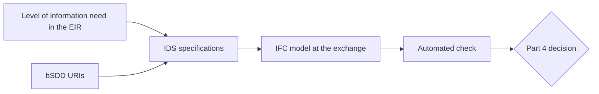

# Level of information need and openBIM

## 1. Purpose of this folder

ISO 19650 says how much information is needed and how delivery is managed. It does not, by itself, define a software schema. This folder collects the open standards that make a level of information need and an exchange checkable: ISO 7817-1 for the level of information need, IFC as the open schema, IDS as a computer-readable specification, and bSDD as the service that holds shared definitions. [P6-S01] [P6-S05] [P6-S09] [P6-S11]

The UK guidance from 2021 already told appointing parties to break information into geometrical information, alphanumerical information, and documentation. ISO 7817-1:2024 is the current international statement of concepts and principles for doing that in a consistent way. EN 17412-1:2020 is no longer the current European text. [P6-S13] [P6-S01] [P6-S02]

None of these standards authorises a party to ignore the EIR. IDS checks a model against a specification. The specification should express a requirement the appointment already made. [P6-S09]

## 2. Key concepts

### Level of information need

ISO 7817-1:2024 specifies concepts and principles for stating the level of information need and for information deliveries when BIM is used. The open abstract says it covers how much detail and how much extent are required across the life cycle, for a general exchange, for collaborative work in progress, and for an appointment. [P6-S01]

The Dutch standards catalogue records that NEN-EN 17412-1:2020 was withdrawn on 1 July 2024 and replaced by NEN-EN-ISO 7817-1:2024. The ISO catalogue page for 7817-1 does not itself say “supersedes”. The draft Part 2 abstract refers to Part 1 as “EN 17412-1, ISO 7817-1”, which is ISO’s own pairing of the two numbers. Treat EN 17412-1 as withdrawn legacy, and study ISO 7817-1. [P6-S02] [P6-S03]

UK Guidance D, citing ISO 19650-1 clause 11.2, uses three subdivisions: geometrical information, alphanumerical information, and documentation. The draft ISO/DTS 7817-2 abstract uses the same three and says Part 2 will show how to state them for an EIR and a BIM execution plan, and how they relate to ISO 29481 (information delivery manual) and to IFC. Part 2 was still at stage 50.20 on 26 November 2026. It is not a published standard. Part 3, a UML model and an XSD, had closed its DIS vote on 6 May 2026 and had no published decision on the catalogue page. [P6-S13] [P6-S03] [P6-S04]

Practical example. For a door at technical design, geometrical information might be width, height, and swing; alphanumerical information might be fire rating and identifier; documentation might be the declaration of performance. An IDS file can check the identifier and the fire rating. It cannot, in IDS 1.0, check the swing geometry, because the 1.0 facet list has no geometry facet. [P6-S09]

### IFC

ISO 16739-1:2024 is edition 2 of the IFC data schema. It withdrew edition 1 (2018). The open abstract says this edition adds infrastructure: bridges, roads, railways, waterways, and ports. It publishes a schema, documentation, property and quantity sets, and an exchange-file structure. A model view definition is a subset of the schema for a particular delivery. Software states which model view it conforms to. [P6-S05]

buildingSMART’s release table identifies IFC 4.3 ADD2, version 4.3.2.0, published 2024-04, as the official release for ISO 16739-1:2024. The HTML documentation says it has the same schema as the ISO release, plus examples and clarifications, and that it is licensed CC BY-ND 4.0. The documentation was not downloaded: the host asks AI use to stay at “reference”. [P6-S06] [P6-S08]

IFC is how parties can exchange a structured model. It is not the information-management process. ISO 19650 still decides who needs the model, when, and to what level. [P6-S07]

### IDS 1.0

IDS is a buildingSMART standard, released as v1.0.0 on 3 June 2024 after a positive vote of the standards committee. The release note says talks about a CEN or ISO publication were still to come. It is not an ISO number on this date. The schema file in the git tag has `version="1.0.0"`. [P6-S09]

An IDS file is a list of specifications. The manual’s own example is that “all walls must have a fire rating property”. Each specification has a description for humans, an applicability section that selects objects, and a requirements section that states what those objects must have. Both sections are built from facets. [P6-S09]

The 1.0 manual lists six facets: entity (IFC class and predefined type), attribute (name and value), classification (system and value), property (property set, name, and value), material (value), and parts (entity and relationship). The schema element for the last of these is `partOf`. There is no geometry facet in that list. A property value may be omitted if the requirement is only that the property exists. Complex restrictions can limit a value to a list, a range, or a pattern. [P6-S09]

The file `buildingsmart_ids-aachen-example-schema-0.9.7_2022.ids` is inside the v1.0.0 tag but points its `schemaLocation` at IDS 0.9.7. Do not use it as a 1.0 specimen. [P6-S09]

The public web page “What is IDS” still describes the standard as in development and says that, at the time of that chapter, IDS could not define geometry. Prefer the tagged manual for the facet list. The page remains useful for the bSDD relationship. [P6-S10]

Practical example, in plain English, of one 1.0 specification: “This specification applies to every IfcSpace. Each of those spaces shall have the property NetFloorArea in the set Pset_SpaceCommon, and the value shall be a positive number.” The manual would split that into applicability (entity IfcSpace) and a property requirement. Writing the XML is a software task. The English sentence is the specification the appointment should be able to recognise. [P6-S09]

### bSDD

bSDD is a free buildingSMART service for publishing and referencing definitions of classes and properties. The service page says it is not itself a standard. It implements ideas from ISO 12006-3, ISO 23386, and ISO 23387. Content is published by organizations. Once a version is Active, its URI stays stable; changes are a new version. The page says the IFC content currently loaded is IFC 4.3, and that it is the dictionary of tangible objects and properties, not the whole schema. [P6-S11]

IDS can point to a bSDD property or class by URI instead of copying the definition. The referencing note maps IDS 1.0 classification fields onto bSDD: the classification system and URI, and the class value and URI. The same pattern exists for properties. [P6-S12]

The difference, in the service’s own example, is that bSDD can define what a kitchen and a net area are, while an IDS file can require that a particular model contain at least one such kitchen with a net area above a stated value. [P6-S11]

### Templates

There is no ISO template for a BEP, an EIR, a TIDP, or a responsibility matrix. The UK information-protocol templates are the official open templates found for the appointment document, and they are link-only because the licence does not clearly allow a copy in this vault. See folder 02. [P6-S13]

The Eng Hub publishes TIDP, MIDP, and BEP outlines and says they follow the content Part 2 asks a pre-appointment plan to cover, with status codes from the 2021 UK National Annex. That is a T4 aid. It does not define the standard. [P6-S15]

CIBSE DE3 (2016) and its EIR, BEP, and TIDP templates are legacy (predecessor). They were written for PAS 1192-2:2013. Use them only to see what changed. [P6-S16]

Guidance Part B (September 2020) introduces open data, buildingSMART, and COBie in the UK framework. It predates IFC 4.3 and IDS 1.0, so it is context, not the current technical source. [P6-S14]

## 3. Process

1. State the level of information need in the EIR, using geometrical, alphanumerical, and documentation needs. [P6-S13] [P6-S01]
2. Where a check can be automated, write an IDS specification whose applicability and requirements match that EIR line. Reference bSDD URIs for shared definitions. [P6-S09] [P6-S12]
3. The author produces an IFC model, naming the schema and, where relevant, the model view. [P6-S05] [P6-S07]
4. The reviewer runs the IDS check and the other Part 4 criteria. A passed IDS file is not, by itself, acceptance of the deliverable. [P6-S09]

## 4. Glossary

| Term | Acronym | Paraphrased definition | Defined in | OBP/guidance link | Confidence |
| --- | --- | --- | --- | --- | --- |
| Level of information need | — | The concepts for stating how much information, and of what kind, an exchange requires. Not abbreviated. | ISO 7817-1:2024 abstract; ISO 19650-1 clause 11.2 in UK guidance | [P6-S01] [P6-S13] | High |
| Geometrical information | — | The shape and spatial part of the level of information need. | Guidance D, citing clause 11.2 | [P6-S13] | High |
| Alphanumerical information | — | The data and identifiers, as distinct from geometry and from documents. | Guidance D | [P6-S13] | High |
| Documentation | — | The documentary part of the level of information need, such as certificates. | Guidance D | [P6-S13] | High |
| Industry Foundation Classes | IFC | Open schema and exchange structure for information shared among construction and facility-management applications. | ISO 16739-1:2024 | [P6-S05] | High |
| Model view definition | MVD | A subset of the IFC schema required for a particular delivery. | ISO 16739-1:2024 abstract | [P6-S05] | High |
| Information Delivery Specification | IDS | buildingSMART XML standard for human-readable and machine-checkable information requirements against IFC. | IDS 1.0 manual and schema | [P6-S09] | High |
| Applicability | — | The part of an IDS specification that selects which objects are in scope. | IDS 1.0 specifications note | [P6-S09] | High |
| Facet | — | One structured kind of information used in applicability or requirements. Six are defined in IDS 1.0. | IDS 1.0 specifications note | [P6-S09] | High |
| buildingSMART Data Dictionary | bSDD | A service for publishing stable definitions that IFC and IDS can reference by URI. Not a standard. | bSDD service page | [P6-S11] | High |
| Information delivery manual | IDM | ISO 29481, which the draft LOIN Part 2 abstract says it will relate to level of information need. The IDM text was not read. | Named in the ISO/DTS 7817-2 abstract | [P6-S03] | Medium |

## 5. Common misconceptions

- EN 17412-1:2020 is still the European level-of-information-need standard. NEN records it as withdrawn on 1 July 2024 and replaced by the ISO adoption. [P6-S02]
- “LOD 300” satisfies ISO 19650. The UK concepts guidance says level of information need is not abbreviated, and ISO 7817-1 is the current concepts standard. A legacy LOD label can be used only as a local explanation inside a defined framework. [P6-S13] [P6-S01]
- IFC is a substitute for an EIR. IFC is a schema. The EIR states the need. A model view is the subset used for one delivery. [P6-S05] [P6-S07]
- IDS 1.0 checks geometry. The six facets in the 1.0 manual do not include geometry. [P6-S09]
- bSDD and IDS are the same thing. bSDD publishes definitions. IDS states project requirements and can point at those definitions. [P6-S11]
- Any file in the IDS git tag is a 1.0 example. The Aachen sample still references schema 0.9.7. [P6-S09]
- A 2016 CIBSE BEP template is an ISO 19650 template. DE3 states that it is based on PAS 1192-2:2013. [P6-S16]

## 6. Links to other parts

- Where level of information need sits in the EIR and the TIDP: [folder 01](../01_ISO_19650_1_Concepts_and_CDE/summary_and_terms.md) and [folder 02](../02_ISO_19650_2_Delivery_Phase/summary_and_terms.md).
- Operational information that may also be specified this way: [folder 03](../03_ISO_19650_3_Operational_Phase/summary_and_terms.md).
- The human decision that follows an automated check: [folder 04](../04_ISO_19650_4_Information_Exchange/summary_and_terms.md).

## 7. Open questions / unverified items

- The byte identity of the local `ids.xsd` and https://standards.buildingsmart.org/IDS/1.0/ids.xsd was not checked. Both claim version 1.0. The local file is the git tag copy.
- ISO/DTS 7817-2 and ISO/DIS 7817-3 may be published or sent back for another vote after this date. Their drafts were not read beyond the open abstracts. [P6-S03] [P6-S04]
- Whether IDS will become an ISO or CEN standard is UNVERIFIED beyond the release note’s statement that talks were expected. [P6-S09]
- The development branch of the IDS repository may be ahead of v1.0.0. This vault uses the tag.
- COBie is named in Guidance B and was not studied as a separate standard. [P6-S14]

## 8. Language notes

### Collocations

- specify the level of information need — state geometry, data, and documents for a purpose
- supersede an earlier European standard — replace it with the ISO adoption
- exchange an IFC model — send a schema-based model between applications
- conform to a model view definition — implement the subset the software claims
- write an information delivery specification — express requirements so a tool can check them
- select objects by applicability — say which entities the specification covers
- require a property — state the property set and name the objects must carry
- reference a definition by URI — point at bSDD instead of copying the text
- publish a dictionary version — make a bSDD definition stable
- validate a deliverable against the specification — run the check
- keep the schema unmodified — a CC BY-ND condition on the IDS files in this folder
- distinguish a service from a standard — bSDD is the service; IDS and IFC are the standards

### Formal patterns

ISO abstracts use “this document specifies” for a standard and “this document gives guidelines” when the draft is guidance. “In accordance with ISO 16739-1” means the file follows that schema, not merely that it is called IFC. “Prior to publication of Part 2” is the correct status of the LOIN application guidance on this date.

### Easily confused terms

- Level of information need / level of detail / LOD. Only the first is the current international term.
- IFC / IDS. IFC holds the model. IDS holds the requirements used to check a model.
- bSDD / IDS. Definitions versus a project specification.
- IDS 1.0 / IDS 0.9.7. The tag is 1.0. Some sample files inside it are older. Read `schemaLocation`.

### Model sentences

The level of information need for each exchange is stated in the exchange information requirements as geometrical information, alphanumerical information, and documentation.

An IDS 1.0 specification selects the relevant IFC entities in its applicability section and states the properties, attributes, classifications, materials, or relationships those entities must satisfy.

A successful IDS check supports the Part 4 review; it does not replace the appointing party’s decision to accept the information container.
